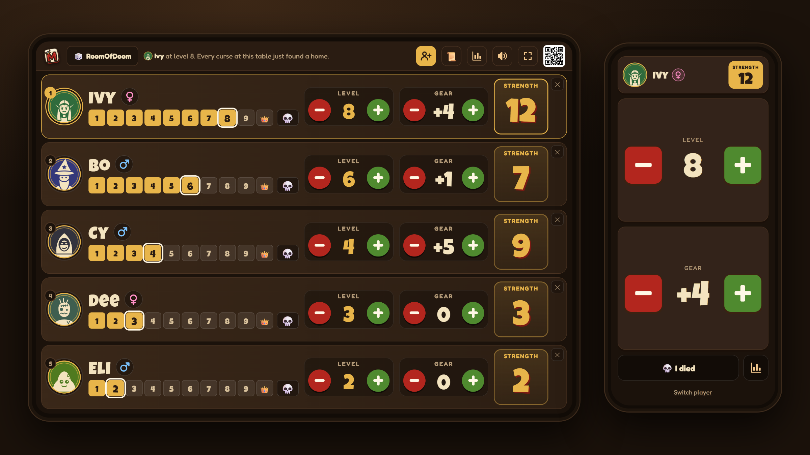
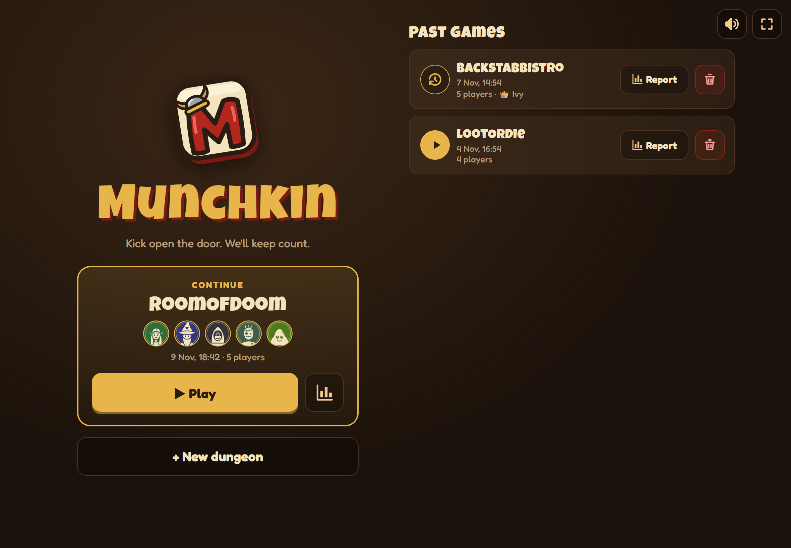
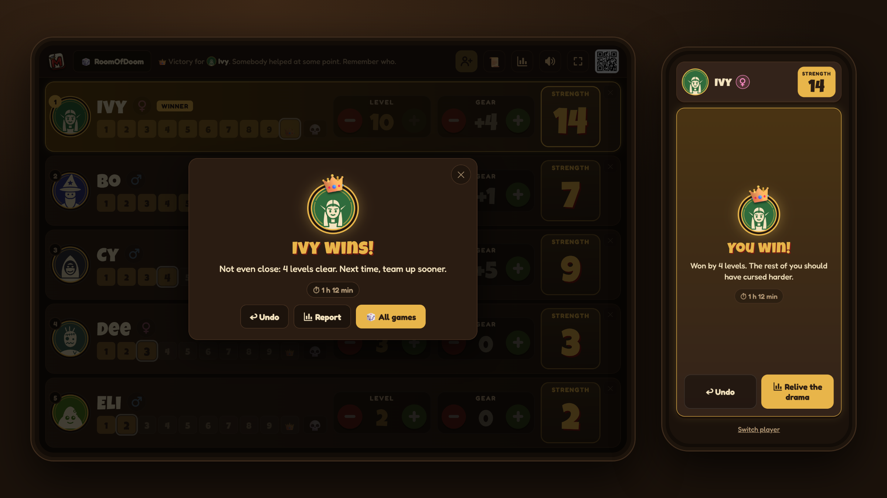
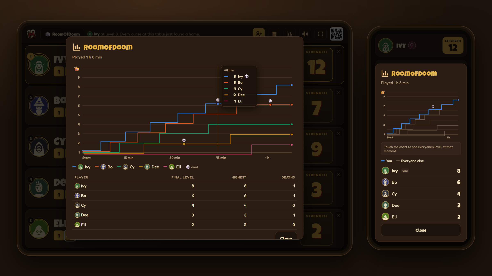

# Munchkin Counter

A level counter for the Munchkin card game, as a Home Assistant add-on.

A tablet (or TV) shows every player at the table, and each player controls their own
level and gear from their phone by scanning a QR code. Munchkin rules are built in,
with an announcer, sound effects, background music and a game history.









## Installation

Add this repository to Home Assistant:

1. Go to **Settings** → **Add-ons** → **Add-on Store**
2. Click menu (⋮) → **Repositories**
3. Add: `https://github.com/christina-thd/munchkin-counter`
4. Install **Munchkin Counter** from the store

## Add-ons

### Munchkin Counter

Tablet/TV dashboard and phone controls for Munchkin, over your home network.

**Features:**
- Dashboard for up to 6 players on one screen, phones join by QR code
- Levels 1–10, gear, strength, and Munchkin death rules
- Male / female characters and character avatars
- Munchkin-style announcer and sound effects
- Background music: original tavern and dungeon tunes
- Start page with past games
- Game report: every player's level over the whole game

[Documentation →](./munchkin-counter/README.md)

## Development

The app is plain Node.js with no build step. See
[munchkin-counter/docs/DEVELOPMENT.md](./munchkin-counter/docs/DEVELOPMENT.md).

```sh
cd munchkin-counter
npm install
npm run check   # lint, types and tests
npm run dev
```

## Credits

Instrument sounds for the background music: the FluidR3_GM soundfont, via
[midi-js-soundfonts](https://github.com/gleitz/midi-js-soundfonts), licensed
[CC BY 3.0](https://creativecommons.org/licenses/by/3.0/). The tunes are original.

## Support

For issues, check the add-on logs or open an issue in this repository.

Munchkin is a trademark of Steve Jackson Games. This is an unofficial fan project, not affiliated with or endorsed by Steve Jackson Games.
